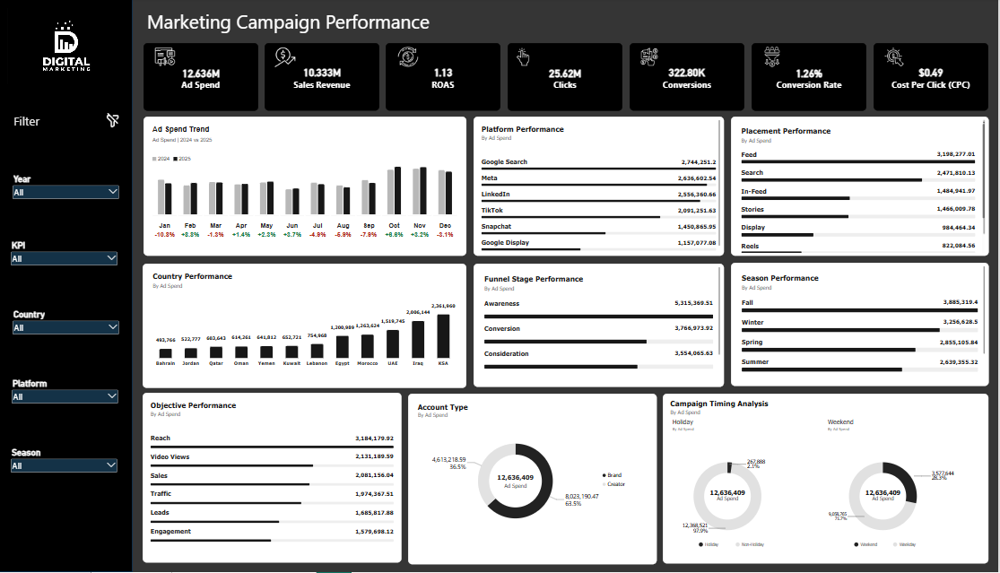

# Digital Marketing Campaign Performance Analysis

## Project Overview

This project analyzes digital marketing campaign performance across advertising platforms, placements, campaign objectives, funnel stages,
countries, seasons, account types, and campaign timing patterns.

Built in **Microsoft Power BI**, the interactive dashboard helps answer
two business questions: **where is the marketing budget being spent, and
which areas appear to use that budget most efficiently?**

## Dashboard Preview




## Business Objectives

-   Monitor advertising spend, sales revenue, clicks, conversions, and ROAS.
-   Compare Google Search, Meta, LinkedIn, TikTok, Snapchat, and Google Display.
-   Evaluate placement-level performance and potential budget-allocation opportunities.
-   Understand campaign objectives and funnel-stage spending.
-   Compare investment and efficiency across countries and seasons.
-   Analyze spending by account type, holidays, and weekdays/weekends.
-   Turn findings into practical campaign-optimization recommendations.

## Tools & Technologies

-   **Microsoft Power BI** --- interactive dashboard and reporting
-   **Power Query** --- data preparation and transformation
-   **DAX** --- calculated measures and performance KPIs
-   **Excel** --- supporting data inspection and preparation, where
    applicable

## Dashboard KPIs

The following values are shown in the unfiltered dashboard view:

  KPI                      Reported Value
  ---------------------- ----------------
  Ad Spend                        12.636M
  Sales Revenue                   10.333M
  ROAS                               1.13
  Clicks                           25.62M
  Conversions                     322.80K
  Conversion Rate                   1.26%
  Cost Per Click (CPC)               0.49

### KPI Definitions

``` text
CTR = Clicks / Impressions × 100
CPC = Ad Spend / Clicks
CPM = Ad Spend / Impressions × 1,000
Conversion Rate = Conversions / Clicks × 100
CPA = Ad Spend / Conversions
ROAS = Attributed Revenue / Ad Spend
```

**Revenue and ROAS note:** The reported ROAS uses total revenue that
includes Sales Revenue and Lead Value.


------------------------------------------------------------------------

# Key Dashboard Analysis & Insights

## 1. Overall Marketing Performance

The dashboard reports approximately **12.636M** in advertising spend,
**10.333M** in sales revenue, **25.62M** clicks, **322.80K**
conversions, a **1.26%** conversion rate, **0.49** average CPC, and
**1.13** reported ROAS.

**Insight:** Sales revenue alone is lower than advertising spend. The
reported ROAS is higher because the total-revenue calculation also
includes Lead Value. Sales-only and blended performance should therefore
be evaluated separately.

## 2. Platform Performance

  Platform           Ad Spend
  ---------------- ----------
  Google Search        2.744M
  Meta                 2.637M
  LinkedIn             2.556M
  TikTok               2.091M
  Snapchat             1.451M
  Google Display       1.157M

### Key Insights

-   **Google Search** is the strongest platform in the comparative analysis, leading in ROAS, CTR, and conversion rate, and performing
    strongly in cost-efficiency metrics.
-   **LinkedIn** receives one of the largest budget allocations but records the weakest ROAS in the platform comparison, alongside
    relatively weak CTR and high CPC/CPA.
-   **Meta** is among the stronger platforms across several performance indicators.
-   **TikTok** shows comparatively strong engagement and conversion-rate performance in the platform comparison.
-   **Snapchat** has relatively competitive CPC, but weaker conversion and return metrics than the leading platforms.
-   **Google Display** requires further review because its conversion and return indicators are comparatively weak.

**Business interpretation:** High advertising spend does not necessarily
translate into high returns. Google Search appears to convert its
investment more efficiently, while LinkedIn deserves further
investigation before additional budget is allocated.


## 3. Placement Performance

  Placement     Ad Spend
  ----------- ----------
  Feed            3.198M
  Search          2.472M
  In-Feed         1.485M
  Stories         1.466M
  Reels           0.822M
  Display         0.484M

### Key Insights

-   **Feed** receives the largest share of placement spend.
-   Search and In-Feed are among the leading placements by clicks.
-   Search, Performance Max (PMax), and Reels appear among the stronger
    options in the detailed efficiency comparisons.
-   Feed and Message Ads were identified as weak placements in parts of
    the comparison. Within LinkedIn, however, Message Ads had higher CTR
    and conversion rate than Feed.
-   Feed generated more total clicks and conversions than Message Ads,
    but had a slightly higher CPA.

**Business interpretation:** A placement can generate more clicks and
conversions because it receives more budget. CPA, conversion rate, and
ROAS are needed to determine whether the additional spend is justified.


## 4. Country Performance

### Highest-Spend Countries

Saudi Arabia (KSA), Iraq, and UAE are the leading countries by
advertising spend and are also among the leaders in clicks.

### Stronger Efficiency Indicators

-   **Oman, Lebanon, and Kuwait** appear among the strongest countries
    in ROAS.
-   **Oman, Jordan, and Kuwait** appear among the strongest countries in
    CPA efficiency.

**Insight:** The countries receiving the largest advertising budgets are
not necessarily those generating the strongest returns. KSA, Iraq, and
UAE lead in spend and clicks, while Oman, Lebanon, and Kuwait appear
among the strongest markets by ROAS.


## 5. Funnel Stage Performance

  Funnel Stage      Ad Spend   Approx. Spend Share
  --------------- ---------- ---------------------
  Awareness           5.315M                 42.1%
  Conversion          3.767M                 29.8%
  Consideration       3.554M                 28.1%

### Key Insights

-   Awareness receives the largest budget allocation.
-   Conversion ranks first in the detailed comparison for clicks, CTR,
    and conversion rate.
-   Consideration appears between Conversion and Awareness in several
    engagement and conversion indicators.

**Business interpretation:** The budget is weighted toward Awareness,
while Conversion campaigns show stronger direct-response indicators.
This may create an opportunity to review the balance between
upper-funnel investment and lower-funnel outcomes.


## 6. Campaign Objective Performance

  Campaign Objective     Ad Spend
  -------------------- ----------
  Reach                    3.184M
  Video Views              2.131M
  Sales                    2.081M
  Traffic                  1.974M
  Leads                    1.686M
  Engagement               1.580M

### Key Insights from the Detailed Comparison

-   **Reach** receives the largest budget allocation.
-   **Sales** ranks strongly in CTR and conversion rate.
-   **Leads** appears among the strongest objectives in conversion rate
    and CPA.
-   **Reach** and **Video Views** perform strongly in some traffic-cost
    comparisons, but should also be evaluated using awareness- and
    video-specific metrics.

**Business interpretation:** The largest budget is allocated to Reach,
followed by Video Views, while Sales receives a smaller share. This
indicates substantial investment in awareness-oriented activities.


## 7. Season Performance

  Season     Ad Spend
  -------- ----------
  Fall         3.885M
  Winter       3.256M
  Spring       2.855M
  Summer       2.640M

**Insight:** Fall and Winter lead in advertising spend. The detailed
comparison also places these seasons among the strongest in several
activity and performance metrics, including clicks, ROAS, conversion
rate, CTR, CPA, and CPC.


## 8. Account Type

  Account Type     Ad Spend   Spend Share
  -------------- ---------- -------------
  Brand              8.023M         63.5%
  Creator            4.613M         36.5%

**Insight:** Brand accounts receive nearly two-thirds of the advertising
budget, while Creator accounts receive the remaining share.

## 9. Campaign Timing Analysis

-   Approximately **97.9%** of spend occurs on non-holidays.
-   Approximately **71.7%** of spend occurs on weekdays.
-   Approximately **28.3%** of spend occurs on weekends.

**Insight:** Advertising investment is concentrated on regular days and
weekdays. This describes the current scheduling pattern, but does not
establish that these periods are more effective.

------------------------------------------------------------------------